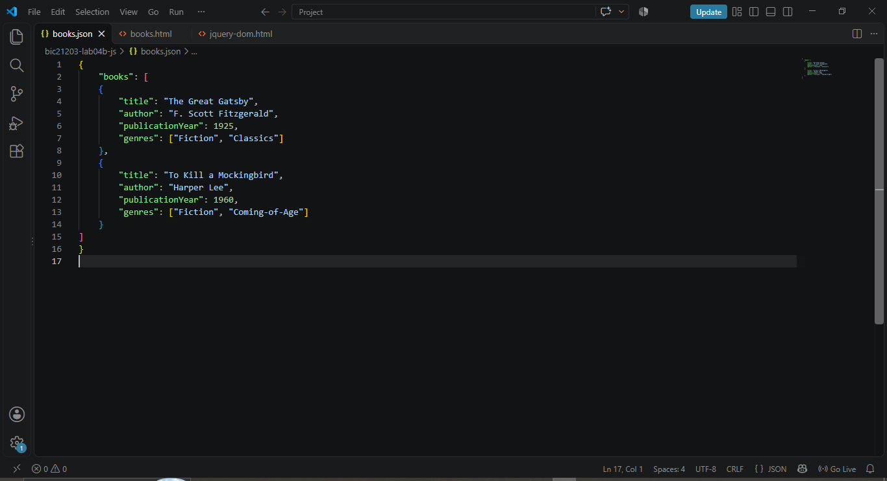
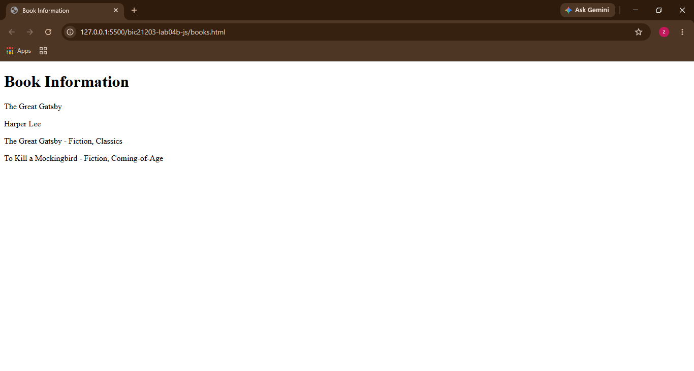
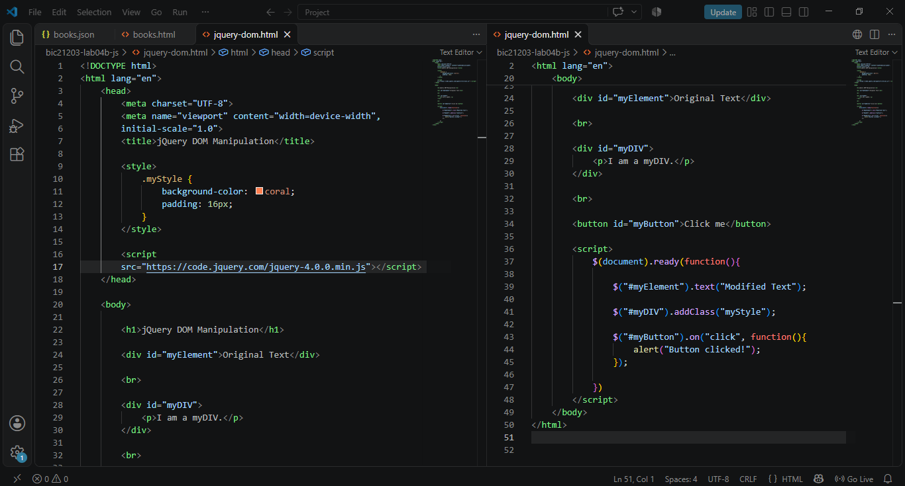

### BIC 21203 Web Development
Lab 4b: Client-Side Scripting (JSON and jQuery)
Name: Nur Zafirah binti Rifai
Matric No.: AI240054
Section: 4

### Setup Instructions
1. Download or clone this GitHub repository.
2. Open the project folder using Visual Studio Code.
3. Install the Live Server extension in VS Code.
4. Open books.html.
5. Click *Go Live* at the bottom-right corner of VS Code.
6. The browser will display the book information retrieved from books.json.
7. To test jQuery, open jquery-dom.html and click *Go Live*.
8. Click the *Click me* button to display the alert message.

    *Note: Do not open books.html directly using file://. Use Live Server to ensure the fetch() function works correctly.*

### Scrennshots

Question 1: JSON Data
   

Question 2: Retrieve and Display JSON
   

Question 3: jQuery DOM Manipulation
   
   

   
